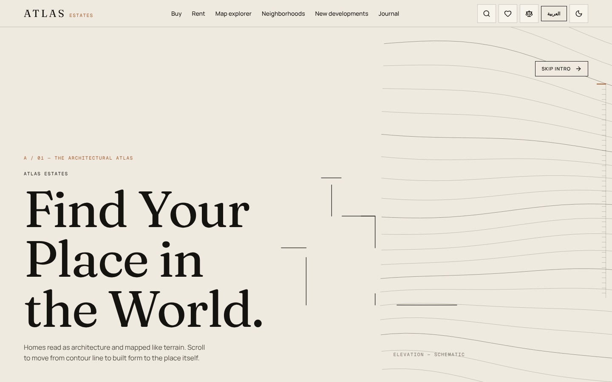
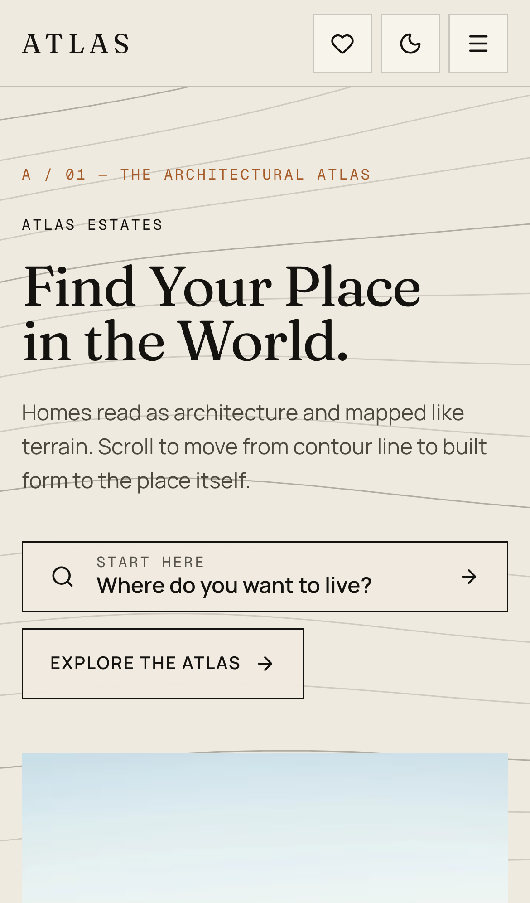

<div align="center">

# Atlas Estates

**A bilingual (English / Arabic RTL) real estate platform built with Next.js 16, React 19 and TypeScript — featuring scroll-driven 3D storytelling, URL-synced property search and a typed, backend-ready API layer.**

[](https://nextjs.org/)
[](https://react.dev/)
[](https://www.typescriptlang.org/)
[](https://tailwindcss.com/)
[](https://threejs.org/)
[](https://gsap.com/)
[](https://playwright.dev/)
<br />
[](https://github.com/Eslamraafat1/New-Real-Estate/actions/workflows/e2e.yml)
[](https://new-real-estate-jade.vercel.app)

[**Live Demo**](https://new-real-estate-jade.vercel.app) · [**Portfolio**](https://new-portfolio-ashy-xi.vercel.app) · [**LinkedIn**](https://www.linkedin.com/in/eslamraafat-dev/)

</div>

<p align="center">
  
  &nbsp;
  
</p>

---

## Overview

**Atlas Estates** is a concept real estate website for a fictional city, *Meridian Bay*. It presents homes as architecture — contour lines, blueprints, floor plans and a procedural 3D building — while covering the full product surface of a real listings platform: search and filters, a map explorer, property detail pages, compare, saved searches, a mortgage calculator and validated lead forms.

> **Portfolio / demo project.** All listings, agents, prices and neighborhood scores are sample data, form submissions are simulated, and the login / account / admin screens are UI demos without real authentication. The data layer is built so a real backend can be swapped in via environment variables (see [`docs/BACKEND_INTEGRATION.md`](docs/BACKEND_INTEGRATION.md)).

**At a glance:** 29 page routes × 2 locales · 9 JSON Route Handlers · 29 sample properties, 8 neighborhoods, 6 agents, 4 developments, 6 articles.

## Key Features

### Property search & browsing
- **Listings** (`/properties`, `/buy`, `/rent`) with **URL-synchronised filters** — purpose, type, style, price, beds/baths, area, furnishing, amenities, completion status — plus filter chips, sorting, grid / list / map views and load-more.
- First 12 results are **server-rendered** into the HTML and seed client state (no extra API round-trip for the default view).
- **Atlas Explorer** (`/map`): provider-agnostic `MapView` with zoom / pan / pinch / keyboard control, marker clustering, fly-to, and synchronised marker ⇄ list ⇄ preview; mobile map/list toggle with a bottom sheet.
- **Property detail**: gallery with fullscreen lightbox (keyboard + swipe, RTL-aware), interactive floor-plan viewer (floors, room highlight, zoom/pan), share / copy / brochure actions, sticky mobile action bar.
- **Compare** (up to 3, differences highlighted), **saved properties** and **saved searches** persisted in `localStorage`.
- **Mortgage calculator** with the formula and a disclaimer shown to the user.
- **Forms** (viewing, contact, seller/landlord, valuation) with shared validators that run **on both client and server**.

### 3D & motion
- Procedural building scene built with **React Three Fiber + Drei**, inside a **GSAP ScrollTrigger**-pinned hero.
- Scroll-driven homepage chapters: blueprint → photograph, pinned horizontal film strip, construction "progress towers", day → dusk wash, parallax galleries, count-up numbers.
- **Framer Motion** micro-interactions, a first-visit preloader, a scroll ruler and a custom cursor layer.
- **Light and dark themes** with a pre-paint theme script (no flash of wrong theme) that respects the system preference.

### Internationalisation & RTL
- `/en` (LTR) and `/ar` (RTL) route trees; `proxy.ts` redirects locale-less URLs based on `Accept-Language`.
- **Type-checked dictionaries** — the Arabic dictionary is typed against the English one, so missing keys fail type-checking.
- Logical CSS utilities (`ms-*`, `pe-*`, `start-*`…) and mirrored directional icons instead of left/right hacks.
- Locale-aware number, currency, area and date formatting; bilingual `{ en, ar }` data fields.
- Per-route **dictionary splitting** — only core namespaces ship on every page; route-specific namespaces are added via `DictScope`.

### Accessibility
- Skip-to-content link, `prefers-reduced-motion` fallbacks (no pinning or 3D under reduced motion), keyboard-operable map, lightbox and floor-plan viewer, native `<dialog>`-based modals.
- Automated **axe-core** scan in the E2E suite (WCAG 2.1 A/AA, serious + critical) on listings, property detail, contact (EN + AR) and FAQ.

## Tech Stack

| Area | Technology |
| --- | --- |
| Framework | **Next.js 16.4.3** (App Router, Cache Components, Partial Prefetching, Turbopack) |
| UI | **React 19.3**, **TypeScript 5.9** (strict) |
| Styling | **Tailwind CSS 4.3**, CSS-variable design tokens |
| 3D | **Three.js 0.186**, @react-three/fiber 9.8, @react-three/drei 10.7 |
| Animation | **GSAP 3.15** (ScrollTrigger), Framer Motion 14.7 |
| Icons | Lucide React |
| Fonts | `next/font/google` — Fraunces, Manrope, Geist Mono, Noto Naskh Arabic, IBM Plex Sans Arabic |
| Testing | **Playwright 1.63** (E2E), **@axe-core/playwright** (accessibility), GitHub Actions |
| Linting | ESLint 9 + `eslint-config-next` (Core Web Vitals + TypeScript) |
| Hosting | Vercel |

## Architecture Highlights

- **Locale routing via `proxy.ts`** (the Next.js 16 replacement for `middleware.ts`): any URL without `/en` or `/ar` is redirected; API routes, `_next` and static files are excluded by the matcher. `app/[lang]/layout.tsx` sets `<html lang dir>` per locale.
- **Typed data layer** — UI never imports demo data directly. Server Components call services in `lib/api/*` (`listProperties`, `getProperty`, …); Client Components use fetchers in `lib/api/client.ts` that hit same-origin `/api/*` Route Handlers.
- **Swappable backend** — each service switches on `DATA_SOURCE`: `demo` serves bundled sample data, `remote` proxies to `BACKEND_API_URL` with a server-only bearer token, so secrets never reach the browser.
- **Shared query model** — `lib/search.ts` provides `parseQuery` / `serializeQuery` / `filterProperties`, used by both the UI (URL state) and the API.
- **3D loading strategy** — the R3F scene is loaded with `next/dynamic` (`ssr: false`) and only mounts when the browser is idle and WebGL is available; the pinned 3D sequence runs only at ≥ 768px without reduced motion, and a static SVG composition is used otherwise. The canvas caps `dpr` at 1.5 and pauses its render loop (`frameloop="never"`) outside its active scroll range.

## SEO & Performance

**SEO** (implemented in code)
- Per-page `generateMetadata` with title templates, descriptions, absolute **canonical URLs** and **`hreflang` alternates** (`en` / `ar`).
- **Site URL can't leak `localhost`:** `lib/api/config.ts` resolves the origin from `NEXT_PUBLIC_SITE_URL` → Vercel's `VERCEL_PROJECT_PRODUCTION_URL` → the production URL, so canonicals, hreflang, sitemap and robots are always absolute `https://` URLs.
- **Open Graph / Twitter cards** on every page: a branded 1200×630 image generated with `next/og` (`app/[lang]/opengraph-image.tsx`) as the default, and the cover photo on property pages.
- Dynamic **`sitemap.xml`** covering every public static route plus all properties, neighborhoods, developments, agents and articles in both languages, with `xhtml:link` alternates. Demo-only pages (login, account, admin, saved, compare) are excluded.
- **`robots.txt`** disallows `/api/`; the demo-only pages carry `noindex` instead (crawlers must be able to fetch them to see it).
- **JSON-LD** structured data: `RealEstateAgent` + `WebSite` (with `SearchAction`) on the home page, `RealEstateListing` with an `Offer` (price, currency, sale/lease) and `BreadcrumbList` on property pages, `FAQPage` on the FAQ. Every entity is flagged as a fictional demo via `disambiguatingDescription`.
- Server-rendered, statically prerendered pages for both locales.
- Unknown detail slugs (properties, neighborhoods, developments, agents, journal) return a real **HTTP 404** with `noindex` on the very first request: the detail routes export `ensureStatic = "navigation"`, so Next.js waits for the static result instead of streaming a fallback with a 200 (`dynamicParams` is not available with Cache Components).

**Performance**
- `next/image` with **AVIF / WebP** output and an allow-listed remote host.
- Code-split heavy components with `next/dynamic` (3D hero scene, lightbox, floor-plan viewer).
- Font budget: Arabic fonts are not preloaded on English pages and Fraunces is limited to a single weight (documented reduction from ~312 KB to ~65 KB of fonts on English pages).
- Listings first page is server-rendered (CLS measured at 0.07 → 0 after the change).
- Paint-heavy effects removed (backdrop blur on sticky header / mobile bar).

Details and measurement notes are in [`IMPLEMENTATION_STATUS.md`](IMPLEMENTATION_STATUS.md).

## Testing & QA

**Automated — Playwright E2E** ([`e2e/`](e2e)) — 43 tests; 69 runs across two projects (Desktop Chrome + Pixel 7 emulation; viewport-independent SEO/a11y checks run on desktop only).

| Suite | What is verified |
| --- | --- |
| **User flows** (`flows.spec.js`) | Listings: a type filter updates the result count (cross-checked against `/api/properties`), the URL (`?type=…`) and the active-filter chips, survives a reload, and *Clear all* restores the full list; sorting by price updates the URL and order; an impossible search shows the empty state. Property detail: lightbox opens, ←/→/End keys and buttons navigate (with wrap-around), Esc and the close button dismiss it. Compare: add from a listing → tray shows "1 of 3" → comparison page lists it → clear. Contact form: required-field and invalid-email errors with `aria-invalid`, then a successful (simulated) submission. Language switch EN → AR keeps the route and sets `lang="ar" dir="rtl"`. 404 handling: unknown routes and unknown detail slugs (all five detail routes, EN + AR, a fresh slug per run) return HTTP 404 on the **first** request with `noindex`, while known slugs from the sitemap return 200. |
| **Hydration** (`hydration.spec.js`) | The home page in EN and AR, light and dark colour scheme, normal and reduced motion (16 runs incl. mobile) hydrates with no React hydration mismatch and no console or page errors. |
| **SEO** (`seo.spec.js`) | `robots.txt` points to an absolute `https` sitemap; `sitemap.xml` lists both locales, only absolute non-localhost URLs and no demo-only pages; canonical + hreflang are absolute; `og:image` is present and the generated PNG actually renders; JSON-LD parses and contains the expected types (`RealEstateAgent`, `WebSite`, `RealEstateListing` with `Offer`, `BreadcrumbList`, `FAQPage`); login/admin/account are `noindex` and labelled as demos. |
| **Accessibility** (`a11y.spec.js`) | axe-core finds no serious/critical WCAG 2.1 A/AA violations on 5 pages (EN + AR). Colour contrast is excluded because animated decorative layers make it unreliable to measure automatically. |
| **Smoke** (`smoke.spec.js`) | 7 key pages return HTTP 200 with the right `<title>`; `/en` is LTR and `/ar` is RTL; unknown routes return 404. |

- **CI** ([`.github/workflows/e2e.yml`](.github/workflows/e2e.yml)): on every push to `master` and every pull request it runs **ESLint → production build → `tsc --noEmit` → starts the build locally → full E2E suite**, uploading the HTML report. A weekly scheduled job (and manual dispatch) runs the same suite against the live deployment.
- The suite caught real bugs that are now fixed: opening a filtered listings URL and then clearing the filters left stale results on screen; several controls had accessible names that didn't contain their visible text (WCAG 2.5.3); compact prices were formatted differently by Node.js and the browser (`$500.0K` vs `$500K`), causing a React hydration error on the home page; and unknown detail slugs answered the first request with HTTP 200.

```bash
npm run build && npm start                 # terminal 1: local production build on :3000
cd e2e && npm ci
npx playwright install chromium
BASE_URL=http://localhost:3000 npm test    # against the local build
npm test                                   # against the live deployment
```

**Manual QA** — documented in [`IMPLEMENTATION_STATUS.md`](IMPLEMENTATION_STATUS.md): production build, `tsc --noEmit` and ESLint checks; route smoke tests across both locales; API filter and validation checks (422 with field errors, simulated 201 submissions); horizontal-overflow audits at 320 / 360 / 390 / 430 / 768 px in EN and AR; dark-theme and reduced-motion checks. Known limitations and untested areas are listed there too.

## Known issues

- None open. Previously listed issues (first request for an unknown listing slug returning HTTP 200, and a React hydration error #418 on the home page of a local production build) are fixed and covered by E2E tests — see [`IMPLEMENTATION_STATUS.md`](IMPLEMENTATION_STATUS.md) for the remaining untested areas.

## Project Structure

```
.
├── app/
│   ├── [lang]/              # All pages, per locale (en | ar): listings, property detail, map,
│   │                        #   compare, neighborhoods, developments, agents, journal, forms…
│   ├── api/                 # Route Handlers: properties, locations, neighborhoods, agents,
│   │                        #   developments, inquiries, viewing- & valuation-requests
│   ├── [lang]/opengraph-image.tsx  # Branded default share image (next/og)
│   ├── sitemap.ts           # Dynamic, bilingual sitemap
│   └── robots.ts
├── components/              # UI by domain: home (3D/motion chapters), listings, property,
│                            #   atlas (map), fx, forms, layout, ui…
├── lib/
│   ├── api/                 # Typed services, client fetchers, validation, remote proxy, config
│   ├── i18n/                # Locale config, typed EN/AR dictionaries, formatters
│   ├── seo/jsonld.tsx       # JSON-LD builders (organization, website, listing, breadcrumbs)
│   ├── search.ts            # URL ⇄ query parsing and filtering
│   └── store.ts             # localStorage stores (favorites, compare, searches, theme)
├── data/demo/               # Sample catalog (fictional city)
├── e2e/                     # Playwright E2E: user flows, SEO, accessibility (axe) and smoke tests
├── docs/                    # Backend integration + developer guides, screenshots
└── proxy.ts                 # Locale redirect
```

## Getting Started

**Prerequisites:** Node.js ≥ 20.9 (required by Next.js 16; CI uses Node 20) and npm.

```bash
git clone https://github.com/Eslamraafat1/New-Real-Estate.git
cd New-Real-Estate
npm install
npm run dev
```

Open http://localhost:3000 — you will be redirected to `/en` (or `/ar` if your browser prefers Arabic).

| Script | Description |
| --- | --- |
| `npm run dev` | Start the dev server |
| `npm run build` | Production build |
| `npm run start` | Serve the production build |
| `npm run lint` | Run ESLint |
| `npm run typecheck` | `tsc --noEmit` (run after a build or `next typegen`, which generates the route types) |

### Environment variables (all optional)

The app runs out of the box on bundled demo data. Copy [`.env.example`](.env.example) to `.env.local` to override anything.

| Variable | Scope | Purpose |
| --- | --- | --- |
| `NEXT_PUBLIC_SITE_URL` | public | Canonical origin for metadata, sitemap and robots (falls back to `VERCEL_PROJECT_PRODUCTION_URL`, then `https://new-real-estate-jade.vercel.app`) |
| `DATA_SOURCE` | server | `demo` (default) or `remote` |
| `BACKEND_API_URL` | server | Base URL of a real API when `DATA_SOURCE=remote` |
| `BACKEND_API_KEY` | server | Bearer token for the remote API (never exposed to the browser) |
| `INQUIRY_WEBHOOK_URL` | server | Optional webhook to forward form submissions |
| `NEXT_PUBLIC_CURRENCY` | public | Default display currency (ISO 4217, default `USD`) |
| `NEXT_PUBLIC_MAP_PROVIDER` | public | Map provider switch (default `demo`) |

## Deployment

Deployed on **Vercel** at **https://new-real-estate-jade.vercel.app**. Import the repository in Vercel (framework preset: Next.js). No environment variables are required: the site URL is taken from Vercel's production domain automatically. Set `NEXT_PUBLIC_SITE_URL` only when serving from a custom domain.

## Documentation

- [`docs/BACKEND_INTEGRATION.md`](docs/BACKEND_INTEGRATION.md) — API contracts, endpoints, environment variables and how to connect a real backend.
- [`docs/DEV_GUIDE.md`](docs/DEV_GUIDE.md) — conventions for Cache Components, i18n/RTL, design tokens and shared components.
- [`IMPLEMENTATION_STATUS.md`](IMPLEMENTATION_STATUS.md) — what is done, how it was validated, and known limitations.

## License

[MIT](LICENSE) © 2026 Eslam Raafat. Photos are loaded from Unsplash under the Unsplash License; all listings, people and the Atlas Estates brand are fictional.

<!-- more-projects:start -->
## More of my work

| Project | What it is | Demo |
|---|---|---|
| **[VANTA](https://github.com/Eslamraafat1/E-commerce-New-)** | 3D bilingual e-commerce storefront | [Live](https://e-commerce-new2-delta.vercel.app/en) |
| **[Crust & Crave](https://github.com/Eslamraafat1/New-Restaurant)** | cinematic restaurant storefront | [Live](https://new-restaurant-kappa.vercel.app) |
| **[NEXORA Academy](https://github.com/Eslamraafat1/Courses-N)** | bilingual e-learning platform | [Live](https://courses-n.vercel.app) |
| **[Nubia](https://github.com/Eslamraafat1/Perfume)** | perfume store on Supabase | [Live](https://perfume-sooty-alpha.vercel.app) |
| **[MONOLITH](https://github.com/Eslamraafat1/3D-Website-)** | 3D architecture studio site | [Live](https://3-d-website-seven-xi.vercel.app) |
| **[Tour Egypt Club](https://github.com/Eslamraafat1/Travel)** | client travel & tours website | [Live](https://touregyptclub.com) |
| **[Portfolio](https://github.com/Eslamraafat1/new-portfolio)** | bilingual Next.js portfolio | [Live](https://new-portfolio-ashy-xi.vercel.app) |

See everything on my [GitHub profile](https://github.com/Eslamraafat1) and [portfolio](https://new-portfolio-ashy-xi.vercel.app/).
<!-- more-projects:end -->

## Author

**Eslam Raafat** — Front-End Developer (React · Next.js · TypeScript)

- Portfolio: [new-portfolio-ashy-xi.vercel.app](https://new-portfolio-ashy-xi.vercel.app)
- LinkedIn: [linkedin.com/in/eslamraafat-dev](https://www.linkedin.com/in/eslamraafat-dev/)
- GitHub: [@Eslamraafat1](https://github.com/Eslamraafat1)
- Email: [eslamraafat736@gmail.com](mailto:eslamraafat736@gmail.com)
